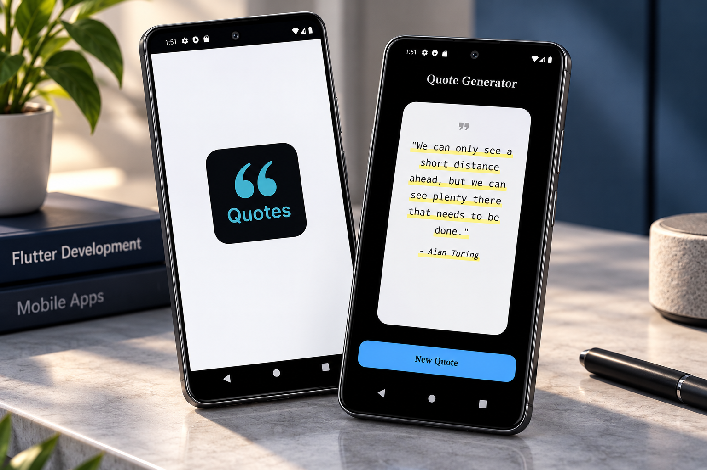

<div align="center">

# 💬 Random Quote Generator

### Flutter • Dart • Inspirational Quotes

A modern Flutter application that displays inspirational and motivational quotes through an elegant, minimalist interface.

Discover meaningful quotes, explore inspiring thoughts, and generate a new quote with a single tap.


</div>

---

## 📸 Project Preview

<div align="center">

<a href="1a686daa-7caa-4172-982b-ffde1bc17830.png">
  
</a>

</div>

---

## 📖 About the Project

**Random Quote Generator** is a Flutter-based mobile application designed to display inspirational and motivational quotes in a simple, visually appealing way.

The project focuses on interactive Flutter UI development, presenting quote content dynamically, and creating an enjoyable reading experience.

Users can discover a new quote with a single tap, along with the name of its author.

---

## ✨ Key Features

### 💬 Inspirational Quotes

- Display motivational and inspirational quotes.
- Generate a new quote with one tap.
- Show quote authors.
- Present quotes in a clean, readable layout.

### 🔄 Random Quote Generation

- Select and display a random quote.
- Update the displayed quote when the user presses **New Quote**.
- Provide a simple, interactive quote browsing experience.

### 🎨 Modern UI/UX

- Elegant dark-themed interface.
- Attractive quote cards.
- Highlighted quote text.
- Clean typography.
- Responsive Flutter layouts.
- Minimalist navigation.

### 📱 Mobile Experience

- Simple and intuitive interface.
- Easy-to-use quote generation button.
- Optimized mobile screen layouts.
- Reusable Flutter UI components.

---

## 📱 Application Screens

| Screen | Description |
|--------|-------------|
| Splash Screen | Quote Generator branding |
| Quote Screen | Displays quotes and authors |
| New Quote | Generates another random quote |

---

## 🛠️ Technologies Used

| Technology | Purpose |
|------------|---------|
| Flutter | Mobile UI development |
| Dart | Application logic |
| Material Design | UI components |
| Git | Version control |
| GitHub | Source code hosting |

---

## 🏗️ Application Architecture

The application follows a simple quote generation workflow.

```text
       Random Quote Generator
                 |
                 v
            Flutter UI
                 |
                 v
          Quote Collection
                 |
                 v
        Random Quote Selection
                 |
                 v
          Quote Display
                 |
                 v
          New Quote Button
                 |
                 v
          Updated Quote
```

---

## 🔄 How It Works

1. The user opens the application.
2. The app displays a quote and its author.
3. The user taps the **New Quote** button.
4. Another quote is selected from the available collection.
5. The interface updates to display the selected quote.

---

## 🎨 UI Design Highlights

The application features:

- Dark navy backgrounds.
- Clean white quote cards.
- Highlighted quote text.
- Large quotation mark icons.
- Elegant typography.
- Modern rounded buttons.
- Consistent spacing and alignment.

The goal is to provide a distraction-free reading experience with an attractive visual design.

---

## 🚀 Getting Started

### Prerequisites

Make sure you have installed:

- Flutter SDK
- Dart SDK
- Android Studio or VS Code
- Git

### 1. Clone the Repository

```bash
git clone <YOUR_QUOTE_GENERATOR_REPOSITORY_URL>
```

Replace the placeholder with your actual GitHub repository URL.

### 2. Navigate to the Project

```bash
cd <YOUR_PROJECT_FOLDER>
```

### 3. Install Dependencies

```bash
flutter pub get
```

### 4. Run the Application

```bash
flutter run
```

---

## 💡 Development Highlights

This project demonstrates experience in:

- Flutter mobile application development.
- Building interactive user interfaces.
- Managing dynamic UI content.
- Implementing random selection logic.
- Working with structured quote data.
- Creating reusable Flutter widgets.
- Designing responsive layouts.
- Developing minimalist mobile applications.

---

## 🎯 Project Goals

- Build a simple inspirational quote application.
- Practice Flutter and Dart development.
- Implement random quote generation.
- Create an attractive mobile interface.
- Improve UI design and state management skills.

---

## 🔮 Potential Future Improvements

- Save favorite quotes.
- Share quotes on social media.
- Copy quotes to the clipboard.
- Search quotes by author.
- Browse quotes by category.
- Daily quote notifications.
- Light and dark themes.
- Multi-language support.

---

## 👨‍💻 Developer

**Ahmed Jaber Ahmed**

Flutter Developer | Mobile App Developer

B.Sc. Computer Science & Artificial Intelligence

📍 Cairo, Egypt

- [GitHub](https://github.com/AhmedJaberAhmed)
- [Portfolio](https://ahmedjaberahmed.github.io/Jaber-website/)
- [LinkedIn](https://www.linkedin.com/in/ahmedjaberahmed/)

---

<div align="center">

### ⭐ Support the Project

If you find this project interesting, consider giving it a star!

**Built with Flutter 💙**

</div>
